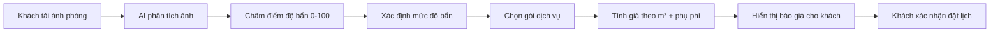

# 🤖 Cleanova AI Module — Quét ảnh độ bẩn & Báo giá tự động

> **Module độc lập, tách hoàn toàn khỏi repo đã cài git.**
> Khi hoàn thiện, chỉ cần copy thư mục này vào dự án chính.

---

## 1. Ý tưởng

Khi khách hàng đặt dịch vụ dọn dẹp, họ **tải ảnh phòng lên** → AI quét ảnh →
phân tích **độ bẩn** → **gợi ý gói dịch vụ + mức giá phù hợp**.

Luồng nghiệp vụ:



---

## 2. Chạy thử ngay

```bash
cd ai-module
npm install
cp .env.example .env      # Windows: copy .env.example .env
npm start
```

> 💡 File `.env` **không được commit** lên git (chứa cấu hình/API key).
> Sau khi clone về, chỉ cần copy từ `.env.example`. Nếu không tạo `.env`,
> module vẫn chạy với giá trị mặc định.

Mở trình duyệt:

| Mục | URL |
|---|---|
| 🎨 Giao diện demo tải ảnh | `http://localhost:5100` |
| ❤️ Health check | `http://localhost:5100/api/ai/health` |
| 📋 Danh mục gói dịch vụ | `http://localhost:5100/api/ai/services` |

> Từ máy khác trong cùng WiFi: `http://<IPv4-của-bạn>:5100` (server đã bind `0.0.0.0`).

---

## 3. API

### `POST /api/ai/analyze`
Chỉ phân tích ảnh, chưa tính giá.

| Field | Kiểu | Bắt buộc | Mô tả |
|---|---|---|---|
| `image` | file | ✅ | Ảnh phòng (jpeg/png/webp/bmp/gif, ≤ 10MB) |

### `POST /api/ai/estimate`
Phân tích ảnh **+** báo giá đầy đủ.

| Field | Kiểu | Bắt buộc | Mô tả |
|---|---|---|---|
| `image` | file | ✅ | Ảnh phòng |
| `areaSize` | number | ✖ | Diện tích m² (mặc định 60) |
| `urgency` | string | ✖ | `normal` \| `soon` (+10%) \| `urgent` (+25%) |
| `extras` | string | ✖ | Danh sách cách nhau dấu phẩy: `mold,grease,pet_hair,post_construction` |

**Ví dụ bằng curl:**

```bash
curl -X POST http://localhost:5100/api/ai/estimate \
  -F "image=@phong.jpg" \
  -F "areaSize=70" \
  -F "urgency=soon" \
  -F "extras=mold"
```

**Kết quả mẫu (đã rút gọn):**

```json
{
  "success": true,
  "data": {
    "analysis": {
      "analyzer": "builtin",
      "overallScore": 88.9,
      "signals": { "clutter": 95.3, "stains": 96.7, "dust": 78.3,
                   "brightness": 67, "debris": 100 },
      "findings": [ { "id": "debris", "label": "Rác, tóc...", "score": 100, "severity": "high" } ]
    },
    "dirtLevel": { "level": "very_heavy", "label": "Rất bẩn", "score": 88.9, "priceMultiplier": 2 },
    "quote": {
      "service": { "code": "premium", "name": "Dọn dẹp chuyên sâu / Tổng vệ sinh", "pricePerSqm": 38000 },
      "areaSize": 70,
      "totalPrice": 6730000,
      "totalPriceLabel": "6.730.000 ₫",
      "priceRange": { "label": "6.057.000 ₫ – 7.403.000 ₫" }
    },
    "recommendations": ["Cần xử lý vết bẩn cứng đầu bằng dung dịch tẩy chuyên dụng.", "..."]
  }
}
```

---

## 4. Cách AI chấm điểm độ bẩn

Engine hiện tại là **heuristic (thống kê đặc trưng ảnh)** — chạy thuần Node.js,
**không cần GPU / API key**, kết quả ổn định (cùng ảnh → cùng điểm).

**5 tín hiệu phân tích** (mỗi tín hiệu 0–100, có trọng số):

| Tín hiệu | Trọng số | Ý nghĩa |
|---|---|---|
| `stains` | 25% | Vết bẩn, ố màu (suy từ độ tối + mật độ cạnh) |
| `clutter` | 20% | Lộn xộn / vật cản (mật độ cạnh ảnh) |
| `dust` | 20% | Bụi & mảng mờ (entropy + mật độ nén) |
| `debris` | 20% | Rác, tóc, mảnh vụn (độ "nhiễu hạt") |
| `brightness` | 15% | Độ sáng tổng thể (càng tối → lâu chưa vệ sinh) |

**Điểm tổng** = trung bình có trọng số → ánh xạ sang **5 mức độ**:

| Điểm | Mức độ | Hệ số giá | Gói gợi ý |
|---|---|---|---|
| 0–24 | Sạch | ×1.0 | Dọn dẹp cơ bản |
| 25–44 | Bẩn nhẹ | ×1.15 | Dọn dẹp tiêu chuẩn |
| 45–64 | Bẩn vừa | ×1.35 | Dọn dẹp sâu |
| 65–84 | Bẩn nặng | ×1.6 | Dọn dẹp sâu / Tổng vệ sinh |
| 85–100 | Rất bẩn | ×2.0 | Tổng vệ sinh chuyên sâu |

**Công thức giá:**

```
Giá = (Đơn giá/m² × Diện tích) × Hệ số độ bẩn × Hệ số phụ phí × Hệ số thời gian
      → áp giá tối thiểu 150.000đ → làm tròn 1.000đ
```

---

## 5. Cắm model AI thật (khi nhóm có model)

Module đã tách sẵn lớp analyzer. Có **2 cách** thay engine:

### Cách A — Gọi service AI bên ngoài (khuyến nghị)

Không cần sửa code, chỉ đổi `.env`:

```env
ANALYZER=external
AI_SERVICE_URL=http://localhost:9000/predict
AI_SERVICE_KEY=your_key
```

Service của bạn (Python/FastAPI, TensorFlow Serving, cloud API…) nhận
`multipart/form-data` field `image` và trả JSON:

```json
{
  "overallScore": 72.5,
  "signals": { "clutter": 60, "stains": 80, "dust": 55, "brightness": 40, "debris": 70 },
  "findings": [ { "id": "stains", "label": "Vết bẩn", "score": 80, "severity": "high" } ]
}
```

> Nếu service lỗi/timeout, module **tự động fallback** về engine builtin.

### Cách B — Thay trực tiếp hàm builtin

Sửa `src/analyzer/imageAnalyzer.js`, thay thân hàm `analyzeImage()` bằng
lời gọi model của bạn. Giữ nguyên cấu trúc trả về là được.

---

## 6. Tinh chỉnh giá & quy tắc

**Mọi con số nghiệp vụ nằm trong 1 file:** `src/config/businessRules.js`

- `DIRT_LEVELS` — ngưỡng điểm & hệ số giá
- `SERVICE_PACKAGES` — gói dịch vụ & đơn giá/m²
- `SURCHARGES` — phụ phí thời gian & tình trạng đặc biệt
- `PRICING` — giá tối thiểu, VAT, làm tròn, diện tích mặc định
- `SIGNAL_WEIGHTS` — trọng số 5 tín hiệu

Chỉnh ở đây là toàn bộ API + UI tự cập nhật.

---

## 7. Cấu trúc thư mục

```text
ai-module/
├── server.js                     # Điểm khởi chạy
├── package.json
├── .env                          # Cấu hình (PORT, HOST, ANALYZER...)
├── src/
│   ├── app.js                    # Express app
│   ├── config/
│   │   └── businessRules.js      # ⭐ Toàn bộ quy tắc giá & độ bẩn
│   ├── analyzer/
│   │   ├── imageAnalyzer.js      # ⭐ Engine chấm điểm bẩn (builtin)
│   │   └── externalAnalyzer.js   # Cầu nối tới model AI bên ngoài
│   ├── pricing/
│   │   └── priceCalculator.js    # ⭐ Tính giá & bóc tách chi tiết
│   └── routes/
│       └── aiRoutes.js           # API endpoints
├── public/
│   └── index.html                # Giao diện demo tải ảnh
└── test/
    └── analyze.test.js           # Test engine (node test/analyze.test.js)
```

---

## 8. Tích hợp vào dự án chính (khi đã hoàn thiện)

Module **không đụng** vào repo git hiện tại. Khi sẵn sàng:

1. **Copy thư mục** `ai-module/` vào repo chính (ví dụ `cleanova/ai-module/`).
2. **Chạy như một service riêng** cùng backend chính:
   ```bash
   # Terminal 1 - backend chính (cổng 5000)
   cd cleanova/backend && node server.js

   # Terminal 2 - AI module (cổng 5100)
   cd cleanova/ai-module && node server.js
   ```
3. **Trong `booking.html`**, thêm bước tải ảnh gọi API:
   ```js
   const form = new FormData();
   form.append('image', fileInput.files[0]);
   form.append('areaSize', areaInput.value);
   const res = await fetch('http://localhost:5100/api/ai/estimate', {
     method: 'POST', body: form
   });
   const { data } = await res.json();
   // data.quote.totalPriceLabel  -> hiển thị giá gợi ý
   // data.dirtLevel.label        -> hiển thị mức độ bẩn
   ```
4. **(Tuỳ chọn) Lưu kết quả AI vào đơn hàng**: thêm cột
   `ai_dirt_score`, `ai_image_url`, `ai_quote` vào bảng `bookings`.

> 💡 Gợi ý: khi tích hợp chính thức, đổi `SERVICE_PACKAGES` trong
> `businessRules.js` thành dữ liệu lấy từ bảng `services` của backend chính
> để giá luôn đồng bộ một nguồn.

---

## 9. Lưu ý

- Engine builtin là **heuristic**, đủ để demo luồng nghiệp vụ. Để chính xác
  theo ảnh thật, nên thay bằng model học sâu (Cách A ở mục 5).
- Ảnh được xử lý **trong RAM**, **không lưu** ra đĩa → không lo rác ổ cứng.
- Giới hạn dung lượng ảnh đổi được qua `MAX_UPLOAD_BYTES` trong `.env`.
- Module dùng cổng **5100** để không đụng backend chính (**5000**).
